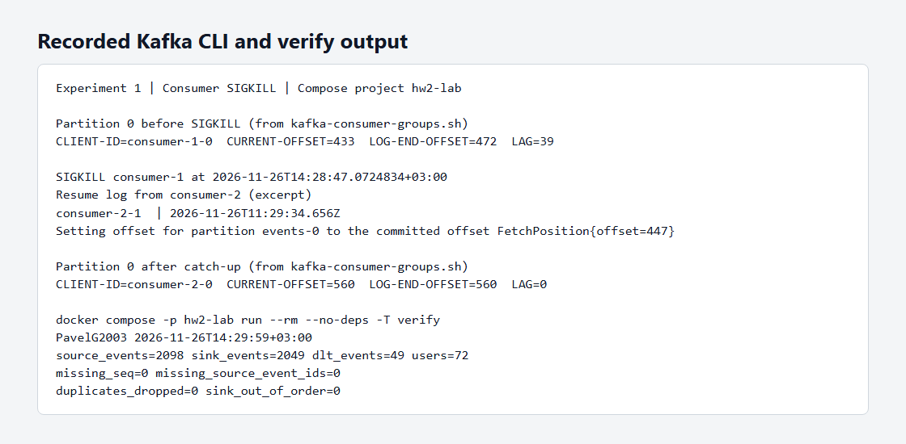
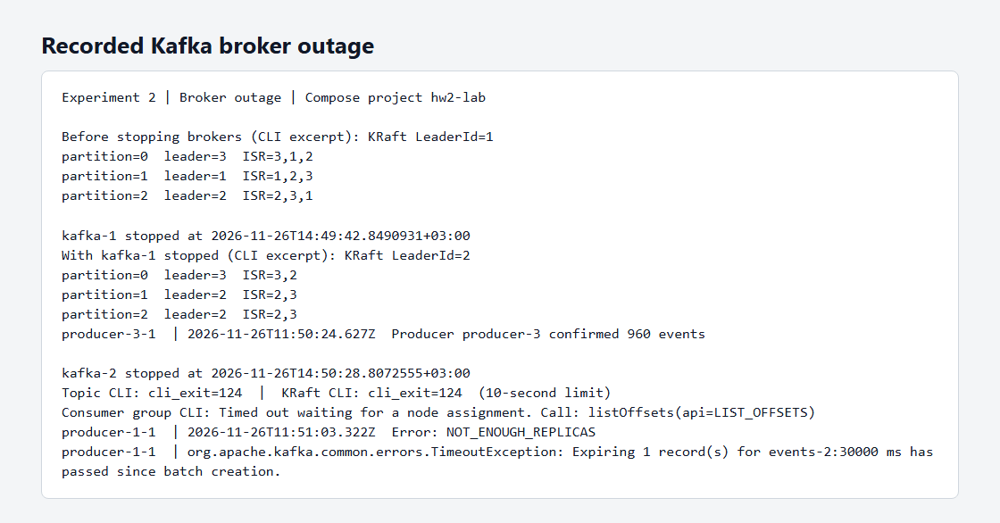
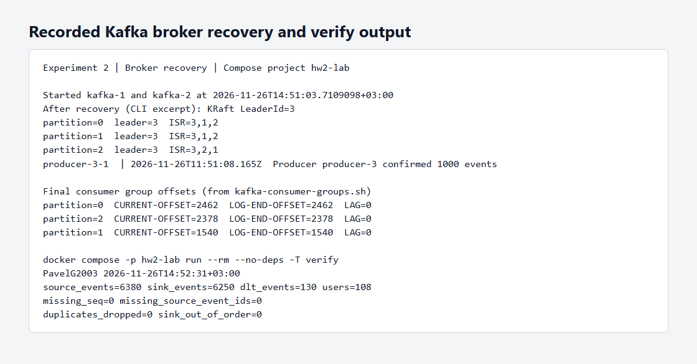
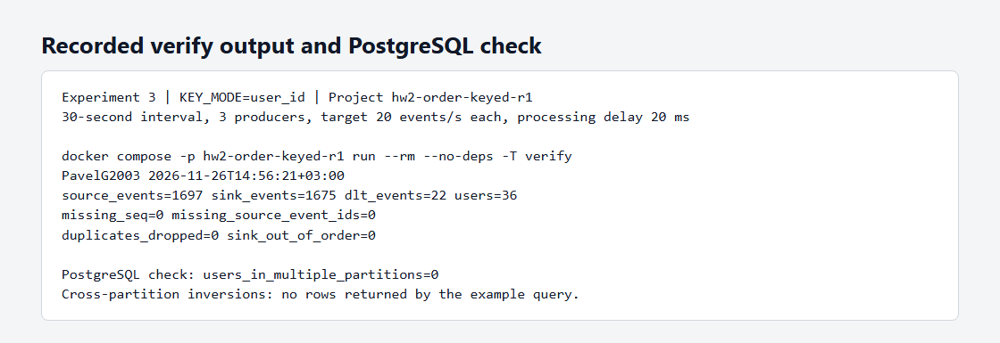
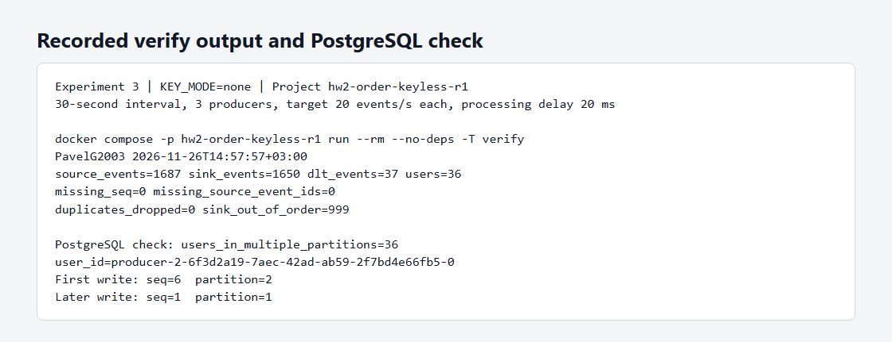

# ДЗ 2. Kafka

Три экземпляра приложения на Java и Spring Boot генерируют события в Kafka. Три консьюмера группы `events-processor` обрабатывают их и сохраняют результат в PostgreSQL. Одноразовый сервис `verify` сверяет содержимое `events`, `events.dlt` и PostgreSQL.

## Запуск

Нужен запущенный Docker с Docker Compose. Выполняйте команды из корня репозитория. Примеры с переменными окружения приведены для PowerShell.

```powershell
$env:KEY_MODE = 'user_id'
docker compose up -d --build
docker compose ps -a
docker compose logs kafka-init
```

`kafka-init` должен завершиться с кодом `0`. Он создаёт топики после запуска трёх брокеров Kafka в режиме KRaft. Автосоздание топиков выключено. В сети Compose брокеры доступны на `kafka-1:9092`, `kafka-2:9092` и `kafka-3:9092`. С хоста используются `localhost:29092`, `localhost:39092` и `localhost:49092`.

| Топик | Партиции | Фактор репликации | Назначение |
| --- | ---: | ---: | --- |
| `events` | 3 | 3 | Входные события. Настроено `min.insync.replicas=2`. |
| `events.dlt` | 3 | 3 | Ядовитые события после трёх неудачных попыток обработки. |

Параметры можно задать в окружении или скопировать [`.env.example`](.env.example) в `.env`.

| Переменная | По умолчанию | Назначение |
| --- | --- | --- |
| `EVENTS_PER_SECOND` | `20` | Целевая частота на одного продюсера. Ожидание подтверждений Kafka может снизить фактическую частоту. |
| `USERS_PER_PRODUCER` | `12` | Число пользователей на экземпляр продюсера. |
| `KEY_MODE` | `user_id` | Ключ `user_id` или `none` для записи без ключа. |
| `PROCESSING_DELAY_MS` | `20` | Имитация обработки одного события в миллисекундах. |
| `GITHUB_LOGIN` | `PavelG2003` | Логин в первой строке вывода `verify`. |

## События и обработка

| Поле | Значение |
| --- | --- |
| `event_id` | UUID события. |
| `user_id` | Идентификатор пользователя. При старте каждый продюсер создаёт собственный набор пользователей. |
| `type` | `page_view`, `add_to_cart` или `purchase`. |
| `seq` | Номер события пользователя, начиная с `1`. |
| `produced_at` | Время генерации события. |
| `payload` | JSON-объект. Флаг `poison` устанавливается с вероятностью 2%. |

Продюсер отправляет события с `acks=all` и `enable.idempotence=true`. Он ждёт подтверждения текущего события перед генерацией следующего, логирует ошибки отправки и при штатной остановке дожидается завершения текущей отправки.

Консьюмер ждёт `PROCESSING_DELAY_MS`, затем записывает в PostgreSQL `user_id`, `seq`, `event_id`, идентификатор консьюмера, исходные топик, партицию и оффсет. Уникальный индекс по `event_id` защищает от повторной записи. Счётчик `duplicates` увеличивается в той же транзакции, в которой обнаружен дубль.

Автокоммит отключён. Консьюмер синхронно коммитит оффсет после каждой записи в PostgreSQL, поэтому при штатной передаче партиции коммит не нужно откладывать до ребаланса. Для ядовитого события консьюмер делает три попытки обработки и коммитит оффсет после подтверждённой публикации в `events.dlt`. В заголовках DLT сохраняются причина ошибки и исходные топик, партиция и оффсет. `auto.offset.reset=earliest` позволяет новой группе читать с самого раннего доступного оффсета. При наличии валидного коммита группа продолжает с него.

## Проверка

После прогона остановите продюсеров, оставив консьюмеров, Kafka и PostgreSQL работающими. Повторяйте команду проверки группы, пока по всем трём партициям `events` не будет `LAG=0`. Затем запустите `verify`.

```powershell
docker compose stop producer-1 producer-2 producer-3
docker compose exec -T kafka-3 /opt/kafka/bin/kafka-consumer-groups.sh --bootstrap-server kafka-3:9092 --describe --group events-processor
docker compose run --rm --no-deps -T verify
```

Первая строка `verify` содержит GitHub-логин и текущее время. Сохраните её на скриншоте вместе с результатом.

| Поле вывода | Что показывает |
| --- | --- |
| `source_events`, `sink_events`, `dlt_events`, `users` | Число уникальных событий во входном топике, число записей в PostgreSQL, число уникальных событий в DLT и число пользователей. |
| `missing_seq` | Сумма пропусков от `1` до наибольшего найденного `seq` каждого пользователя. При поиске пропусков учитываются записи в PostgreSQL и DLT. |
| `missing_source_event_ids` | Число `event_id` из `events`, которых нет ни в PostgreSQL, ни в `events.dlt`. |
| `duplicates_dropped` | Накопительное число повторных попыток записи в PostgreSQL. В опытах со сбоями сравнивайте значения до и после. |
| `sink_out_of_order` | Число записей, у которых `seq` меньше максимального `seq`, уже записанного для того же пользователя. |

## Часть 4. Эксперименты

### Аварийная остановка консьюмера

**Гипотеза до запуска.** Партицию остановленного консьюмера подхватит другой консьюмер после ребаланса. Если PostgreSQL уже сохранил событие, а Kafka ещё не получила коммит оффсета, произойдёт повторная доставка. PostgreSQL отбросит дубль по `event_id`.

Исходный результат стенда с `KEY_MODE=user_id` при `LAG=0` во всех партициях.

```text
PavelG2003 2026-11-26T14:26:27+03:00
source_events=1306 sink_events=1274 dlt_events=32 users=36
missing_seq=0 missing_source_event_ids=0
duplicates_dropped=0 sink_out_of_order=0
```

1. Снимите исходные показания `verify` по инструкции выше, затем запустите продюсеров снова командой `docker compose start producer-1 producer-2 producer-3`.
2. Под нагрузкой снимите назначение партиций и закоммиченные оффсеты. Остановите `consumer-1` сигналом `SIGKILL`. Дождитесь, пока группа перераспределит его партиции, и повторите команды `--describe`.

   ```powershell
   docker compose exec -T kafka-3 /opt/kafka/bin/kafka-consumer-groups.sh --bootstrap-server kafka-3:9092 --describe --group events-processor --members --verbose
   docker compose exec -T kafka-3 /opt/kafka/bin/kafka-consumer-groups.sh --bootstrap-server kafka-3:9092 --describe --group events-processor
   docker compose kill -s SIGKILL consumer-1
   docker compose logs --since 5m consumer-2 consumer-3
   ```

3. Найдите в логах нового владельца партиции её стартовый оффсет и сопоставьте его с последним доступным коммитом. Пока работают два консьюмера, остановите продюсеров, дождитесь `LAG=0` и запустите `verify`. После проверки верните `consumer-1` командой `docker compose start consumer-1`.

**Наблюдения.** Перед `SIGKILL` партиция `events-0` принадлежала `consumer-1`, а её `CURRENT-OFFSET` на момент замера был `433`. После ребаланса партицию получил `consumer-2`. В его логе зафиксирован старт с закоммиченного оффсета `447`. К моменту итоговой проверки все партиции достигли `LAG=0`. Счётчик отброшенных дублей остался на `0`.

**Результат `verify`**

```text
PavelG2003 2026-11-26T14:29:59+03:00
source_events=2098 sink_events=2049 dlt_events=49 users=72
missing_seq=0 missing_source_event_ids=0
duplicates_dropped=0 sink_out_of_order=0
```

**Вывод.** Партиция перешла к другому консьюмеру, и обработка продолжилась с последней позиции, сохранённой в Kafka. Чтобы вырос счётчик дублей, сбой должен прервать обработку именно между записью в PostgreSQL и коммитом оффсета. В этом прогоне повторных попыток записать уже сохранённое событие не было. `verify` также подтвердил, что события не потерялись.



### Остановка одного и двух брокеров

**Гипотеза до запуска.** После остановки одного брокера продюсер продолжит получать подтверждения с `acks=all`: останутся две реплики, что соответствует `min.insync.replicas=2`, и сохранится кворум KRaft из двух контроллеров. После остановки второго брокера ожидаются ошибки `NotEnoughReplicas` или тайм-ауты. Останется одна живая реплика, а один контроллер из трёх не сможет поддерживать кворум. Новые записи перестанут подтверждаться, даже если один из лидеров партиций останется жив.

1. Зафиксируйте исходный результат `verify` и запустите продюсеров. Снимите состояние `events`. Если у `kafka-1` нет лидерства ни в одной партиции, выберите брокер, который ведёт хотя бы одну партицию, и соответственно замените имена в командах. Для CLI используйте живой брокер.

   ```powershell
   docker compose exec -T kafka-3 /opt/kafka/bin/kafka-topics.sh --bootstrap-server kafka-3:9092 --describe --topic events
   ```

2. Остановите первый брокер командой `docker compose stop kafka-1`. Повторите `--describe`, зафиксируйте `Leader` и `Isr` и посмотрите, как изменились подтверждения в логах продюсеров и `LAG` группы.
3. Остановите второй брокер командой `docker compose stop kafka-2`. Снимите логи клиентов и повторите проверки на оставшемся брокере. Зафиксируйте ошибки или тайм-ауты, если CLI недоступен. В этом стенде остановка двух брокеров также останавливает два из трёх контроллеров KRaft. При разборе результатов учитывайте одновременно порог `min.insync.replicas` и доступность кворума.

   ```powershell
   docker compose logs --since 5m producer-1 producer-2 producer-3 consumer-1 consumer-2 consumer-3
   ```

4. Верните брокеры командой `docker compose start kafka-1 kafka-2`. Дождитесь восстановления лидеров и ISR, проверьте возобновление подтверждений у продюсеров. Остановите продюсеров, дождитесь `LAG=0` и запустите `verify`.

**Наблюдения.** После остановки `kafka-1` лидер партиции `events-1` сменился с брокера 1 на брокер 2. В ISR каждой партиции остались брокеры 2 и 3, а лидером кворума KRaft стал брокер 2. Продюсеры продолжили получать подтверждения, консьюмеры продвинули оффсеты.

После остановки `kafka-2` в логах продюсеров появились `NOT_ENOUGH_REPLICAS` и `TimeoutException` после 30 секунд ожидания отправки. Команды описания топика и кворума превысили лимит в 10 секунд. Команда описания consumer group вернула тайм-аут `LIST_OFFSETS`. При этом в логе `consumer-1` видна обработка уже опубликованных событий партиции `events-0` во время сбоя.

После возврата брокеров во всех трёх ISR снова было по три реплики. Все продюсеры возобновили подтверждённую отправку. Консьюмеры дочитали все партиции до `LAG=0`.

**Результат `verify`**

```text
PavelG2003 2026-11-26T14:52:31+03:00
source_events=6380 sink_events=6250 dlt_events=130 users=108
missing_seq=0 missing_source_event_ids=0
duplicates_dropped=0 sink_out_of_order=0
```

**Вывод.** После первого сбоя Kafka сменила лидера и продолжила подтверждать записи, потому что в ISR остались две реплики. После второго сбоя подтверждения остановились. Оставшихся реплик стало недостаточно, а команды, которым нужны сведения о кластере, стали завершаться по тайм-ауту. При этом консьюмеры ещё могли обработать часть уже опубликованных событий. После возврата брокеров отправка и чтение возобновились, а `verify` показал ноль пропусков.





### Порядок с ключом и без ключа

**Гипотеза до запуска.** С ключом `user_id` все события одного пользователя попадут в одну партицию, поэтому ожидаю `sink_out_of_order=0`. Без ключа события одного пользователя могут попасть в разные партиции. Их обрабатывают параллельно, и более позднее событие может попасть в PostgreSQL первым. Поэтому в прогоне без ключа ожидаю `sink_out_of_order` больше нуля.

В обоих прогонах использовались чистые тома Kafka и PostgreSQL. Сначала три консьюмера вступили в группу, затем три продюсера отработали по 30 секунд с целевой частотой 20 событий в секунду на экземпляр. На экземпляр приходилось 12 пользователей, задержка обработки составляла 20 мс.

Для повторения используйте разные имена проектов, чтобы получить отдельные тома. Перед сменой проекта выполните `down` для текущего, чтобы освободить порты.

```powershell
docker compose down
$env:KEY_MODE = 'user_id'
docker compose -p hw2-keyed up -d --build
Start-Sleep -Seconds 30
docker compose -p hw2-keyed stop producer-1 producer-2 producer-3
docker compose -p hw2-keyed exec -T kafka-3 /opt/kafka/bin/kafka-consumer-groups.sh --bootstrap-server kafka-3:9092 --describe --group events-processor
# После LAG=0 во всех партициях
docker compose -p hw2-keyed run --rm --no-deps -T verify
docker compose -p hw2-keyed down

$env:KEY_MODE = 'none'
docker compose -p hw2-keyless up -d
Start-Sleep -Seconds 30
docker compose -p hw2-keyless stop producer-1 producer-2 producer-3
docker compose -p hw2-keyless exec -T kafka-3 /opt/kafka/bin/kafka-consumer-groups.sh --bootstrap-server kafka-3:9092 --describe --group events-processor
# После LAG=0 во всех партициях
docker compose -p hw2-keyless run --rm --no-deps -T verify
docker compose -p hw2-keyless down
$env:KEY_MODE = 'user_id'
```

**Результат `verify` с `KEY_MODE=user_id`**

```text
PavelG2003 2026-11-26T14:56:21+03:00
source_events=1697 sink_events=1675 dlt_events=22 users=36
missing_seq=0 missing_source_event_ids=0
duplicates_dropped=0 sink_out_of_order=0
```

**Результат `verify` с `KEY_MODE=none`**

```text
PavelG2003 2026-11-26T14:57:57+03:00
source_events=1687 sink_events=1650 dlt_events=37 users=36
missing_seq=0 missing_source_event_ids=0
duplicates_dropped=0 sink_out_of_order=999
```

**Вывод.** При сопоставимом объёме данных с ключом получилось 0 нарушений порядка, без ключа — 999. С ключом у каждого пользователя все записи пришли из одной партиции. Без ключа события всех 36 пользователей оказались в нескольких партициях. Например, у одного пользователя PostgreSQL сначала сохранил `seq=6` из партиции 2 и только потом `seq=1` из партиции 1. Консьюмеры читают эти партиции параллельно и могут продвигаться с разной скоростью. В обоих прогонах `verify` показал ноль пропусков и дублей.




